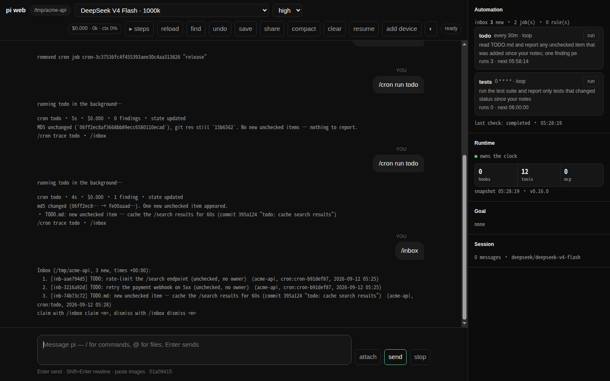

# pi-loops

English · [中文](README.zh-CN.md)

An automation layer for [pi](https://github.com/earendil-works/pi), shipped as a plain pi extension.
Nothing in pi is patched.



A loop wakes up with the notes its last run left, does the work in a sub-agent that starts clean,
and files what it found. You read the findings when you want to, and claim the ones worth a turn.
It all keeps running after you close pi.

## Why this exists

Some work should happen while nobody is watching: the issues opened overnight, the dependency that
picked up a CVE, the test that started failing on main. An agent can do any of it, but only when you
sit down and ask — so the asking is the work. And the two obvious ways to automate it put the result
in the wrong place: a prompt on a timer interrupts you with something you did not want *now*, and a
script writes to a log nobody opens.

> "Stop prompting the agent. Build loops that prompt the agent for you."
> — Addy Osmani, *Loop Engineering*

So the run happens in a sub-agent that never touches your conversation — nothing lands while you are
mid-thought. What it finds waits in an inbox rather than a log: an inbox line is one you can claim, a
log line is one you have to go looking for. And it starts from what the last run wrote down, so what
reaches you is what changed rather than everything that is there.

## Install

Node ≥ 22.6 (pi loads the TypeScript sources directly) and pi ≥ 0.84.3 to load it into — 0.85 is
what this is tested against, and an older pi is refused at load with a line that names the version
it needs, rather than a link error naming one missing export. The host that runs your loops always
runs on node, also when pi runs under bun: it then uses the `node` on your PATH. Nothing else:
pi-loops has no runtime dependencies. What you do want first is a provider you can actually talk to — run `pi`, send
one message, make sure you get an answer. pi-loops runs sub-agents while you are not watching, and
the first sign of credentials that do not work should not be an empty inbox tomorrow morning.

```bash
pi install npm:@alphacoder-v0/pi-loops
```

Working on the code? Install your checkout instead — `pi install .` in this repo — or try it for
one run with `pi -e .`, which installs nothing. Keep one copy, not two: two copies register the
same tools, and pi refuses to load the second — `Tool "cron_create" conflicts with …`, and it
exits.

Then restart pi, and that is the whole install: `/cron`, `/inbox`, `/triggers` and `/goal` are
registered by the extension itself, so they work with nothing on your `PATH` and no launcher. The
`pi-loops` command is a separate thing, needed only for the browser window and the shell
subcommands — [The browser window, and the command line](#the-browser-window-and-the-command-line)
sets it up when you want it. The package also ships a skill (`skills/pi-loops`), so the agent knows
when to reach for `cron_create`, `new_trigger` and the inbox on its own.

## Your first loop

```text
/cron add --stateful --name todo "0 9 * * *" read TODO.md and report any unchecked item that was not in your notes last run
```

Every morning a fresh sub-agent runs with the notes it wrote last time, does the work, and hands
back two things: the notes for tomorrow, and any finding worth your attention. The notes go to a
Markdown file, the findings go to the inbox, and your conversation is never touched. (The run says
which is which in tags that a program reads rather than you — [docs/loops.md](docs/loops.md) has
them.) Here are two runs of that loop, half an hour apart — the first:

```text
cron todo · 5s · $0.000 · 0 findings · state updated
md5 unchanged (`06ff2ec8af3668bb89ecc6580110ecad`), git rev still `15b6562`. No new unchecked items — nothing to report.
/cron trace todo · /inbox
```

The second, after one commit:

```text
cron todo · 4s · $0.000 · 1 finding · state updated
md5 changed (06ff2ec8… → fe00aaad…). One new unchecked item appeared.
• TODO.md: new unchecked item — cache the /search results for 60s (commit 395a124 "todo: cache search results")
/cron trace todo · /inbox
```

The first run found nothing worth saying and said nothing; the second noticed one change and
reported only that. That is what the notes between runs buy — without them every run reports the
whole file every morning, and you stop reading it by Thursday. What they filed waits in the inbox:

```text
/inbox
Inbox (/tmp/acme-api, 3 new, times +00:00):
  1. [inb-aae794d5] TODO: rate-limit the /search endpoint (unchecked, no owner)  (acme-api, cron:cron-b91def87, 2026-09-12 05:25)
  2. [inb-3216a92d] TODO: retry the payment webhook on 5xx (unchecked, no owner)  (acme-api, cron:cron-b91def87, 2026-09-12 05:25)
  3. [inb-74b73c72] TODO.md: new unchecked item — cache the /search results for 60s (commit 395a124 "todo: cache search results")  (acme-api, cron:todo, 2026-09-12 05:28)
claim with /inbox claim <n>, dismiss with /inbox dismiss <n>
```

The third finding is the run above; the two over it came from another loop in the same checkout,
three minutes earlier. The inbox is one queue per project rather than one per job, so everything
watching this repo lands in the same list and you triage it in one pass.

```text
/cron                  # what is scheduled here, and when it next runs
/cron run 1            # do not wait until 9am — run it now and watch
/inbox claim 1         # hand finding #1 to the agent as a real turn
/inbox dismiss 2       # not interesting
/inbox dismiss 3 that file is generated, ignore it    # the loop is told why on its next run
```

## Loops worth stealing

```text
/cron add --stateful --name main-watch "0 9 * * *" read the commits on main since the revision in your notes, report anything that changes the public API, and record the new head revision
```

The others are variations on this shape. The notes carry a revision, and only what changed since it
earns a line in your inbox.

```text
/cron add --stateful --name deps "0 8 * * 1" run npm audit and report advisories whose id is not already in your notes; append every id you report to that list
```

The watermark here is a list rather than a revision, and the loop appends to it as it reports. The
notes are plain Markdown you can read and correct (`/cron state deps`).

```text
/cron add --verify --name ci every 30m run the test suite and report only tests that changed status since your notes
```

`--verify` implies `--stateful` and puts a second, adversarial sub-agent between the findings and
you: a flake that failed once is exactly what should be stopped there, with the reason in
`/cron trace ci 1 checker`. It fails open — if the checker itself breaks, the findings still reach
the inbox, marked unverified, because a broken checker must not silence the loop.

```text
/cron add --stateful --cwd /srv/acme-api --model openai/gpt-5.5 "0 7 * * *" summarize what changed in this repo since your notes
```

A job records its directory and model at creation, so it is not tied to the window it was typed in:
`--cwd` runs it in another checkout (absolute, or relative to this project — no shell, so nothing
expands `~`), and `--model` pins it whatever this session is on (`/cron set <ref> --model -` unpins).

And eight you do not write at all: `/recipe add issue-loop` runs the issue tracker as a state
machine that two loops turn, `/recipe add autoresearch` runs one experiment per run against a
contract you wrote, and `daily-digest`, `pr-watch`, `ci-sweeper`, `deps-sweeper`,
`changelog-draft` and `ecosystem` do what their names say — each a directory of playbooks copied
into the project, installed with one question and one confirmation, and `/recipe show` says
what its runs may never do before you say yes ([docs/recipes.md](docs/recipes.md)). Three are
starters that only read and file findings: `daily-digest`, `pr-watch`, `changelog-draft`.

Two that are not loops:

```text
/new-trigger when ~/build.done exists, run cargo test and show me the result
```

A condition instead of a clock: a sub-agent re-checks it every `[triggers] poll_interval_secs` (600
by default) and acts when it holds — once, unless you ask for a repeat.

```text
/cron add in 45m remind me to look at the deploy
```

No `--stateful`, so this is a plain job: in 45 minutes the prompt lands in *this* conversation and
is answered there rather than filed — a reminder belongs in the chat, a nightly report does not.

## Before you leave it running overnight

```text
/cron cost             # what automation has spent today
/cron disable --all    # pause every job in this project
```

Set a cap in `~/.pi/agent/loops/config.toml` before you rely on it:

```toml
[limits]
daily_budget_usd = 5.0
```

A pi window starts one always-on host when there is work to run. The host runs every loop, rule
check and push, whether or not a window is open. It also runs the plain jobs of closed
conversations, in those conversations; each such run is a model turn. A window runs the plain jobs
of the conversation it holds. After a reboot, work resumes when a pi window opens, or
at login if you install the login unit (`pi-loops host install`; a session start offers it once).
`/cron host` shows or controls the host; `[host] auto = false` disables automatic starts.

## The browser window, and the command line

`pi-loops` is the part that needs a launcher: `pi install` puts the package under pi's managed
directory rather than on your `PATH`, so the command does not exist yet. You are not asked to fix
that by hand — the first pi session after `pi install` offers to put `pi-loops` on your `PATH`, and
keeps that launcher working afterwards if pi ever moves the package. Say no and nothing is written,
and you are not asked again; `/pi-loops install-launcher` writes one whenever you change your mind:

```text
/pi-loops install-launcher            # from inside pi, where the extension is already loaded
```

```bash
# or from a shell, on a machine where pi is never opened — the same command, by absolute path
cd ~/.pi/agent/npm/node_modules/@alphacoder-v0/pi-loops    # installed from npm
cd ~/.pi/agent/git/github.com/alphacoder-v0/pi-loops       # installed from GitHub
node src/cli-entry.mjs install-launcher
```

Any of them writes a launcher into the first of `~/.local/bin` and `/usr/local/bin` that is already
on your `PATH`, and refuses rather than guessing if neither is — pass `--dir <dir>` to say where.
After that, `pi-loops` works from anywhere:

```bash
pi-loops                              # start a session — browser here, terminal over ssh
pi-loops --tui                        # the terminal one, when you want it
pi-loops --continue                   # pick up the newest session in this directory
```

`pi-loops sessions|inspect|export|import` and `pi-loops host status|abort|stop|start|install` need no
pi session open at all. They are for backups from cron or CI, restoring on a fresh machine, and
looking in on the host, which also has a read-only page (`pi-loops host status --url`). See [docs/cli.md](docs/cli.md).

At a local terminal the bare command opens the browser front end; over ssh, or with no terminal at
all, it runs pi itself, because a browser on the far machine helps nobody. Pass `--web` or `--tui`
when that guess is wrong. Anything else you pass goes straight to pi (`pi-loops --model
anthropic/claude-opus-5 -e .`).

Both windows are complete pi sessions — the browser one runs `pi --mode rpc` behind a page — so the
session file, `--resume`, your models, tools and extensions are the same either way, and the model
and thinking level you last chose start the next session whichever window it opens in. The browser
one is a session and not a viewer: what a person can still do after the window changed is a release
gate, and [docs/web-ui-parity.md](docs/web-ui-parity.md) has it line by line.

Even starting over stays in the window — **clear** begins a new session, **resume** goes back to an
earlier one in this project, **compact** summarises what is there and says what it did, as buttons
or as `/clear`, `/new`, `/resume` and `/compact <what to keep>` in the composer. None of them
deletes anything; the session you leave is a file that `resume` lists.

It serves **`http://127.0.0.1:4173/`** by default, with a token that lives in a file, so the address
is the same one tomorrow and is worth bookmarking (`--port` moves it if 4173 is spoken for). The
first visit leaves a cookie and you never see the token again. Running `pi-loops` while one is
already up opens that window instead of failing on the port; `--no-auth` drops even that, on a
machine only you use.

From a phone, the best route is `tailscale serve --bg 4173`: this server stays on loopback and the
tailnet does TLS and identity. On the same wifi, `pi-loops --host 0.0.0.0` works too (and refuses
`--no-auth`). Press **add device** in a browser that is already signed in and point the phone at the
QR it shows: nothing to type, that device stays signed in, and the page can go on the home screen.

### Keeping it up to date

```bash
pi-loops upgrade                      # take the newest release
pi-loops upgrade --check              # just say whether there is one
```

It reads the release tags from the repository this copy came from, compares them with what you are
running, and installs the newest the same way this copy was installed. For a GitHub install that is
the only way to move: `pi update --extensions` keeps the clone on the ref you pinned
([docs/cli.md](docs/cli.md)). An npm install made without a version is one `pi update --extensions`
moves as well, and `upgrade` leaves it that way; one pinned to an exact version stays pinned, to the
new one.

Restart pi (or run `pi-loops` again) to load it. The launcher does not need reinstalling: pi keeps a
package at the same path whatever its version — `~/.pi/agent/npm/node_modules/<name>` or
`~/.pi/agent/git/<host>/<owner>/<repo>`.

Releases are tags on GitHub, published to npm under the same version; [CHANGELOG.md](CHANGELOG.md)
says what is in each one.

### Uninstall

Remove the login unit and stop the host first, one command after the other: the first one fails
where a login unit cannot be used (no systemd or launchd, `PI_LOOPS_DIR` set), and the second must
still run. The host keeps running after pi-loops is removed, and
nothing else stops it:

```bash
pi-loops host uninstall
pi-loops host stop
pi remove npm:@alphacoder-v0/pi-loops             # or git:github.com/alphacoder-v0/pi-loops, or the checkout path — whatever you installed
```

State stays in `~/.pi/agent/loops` until you delete it.

To go back to 0.22.8, do the same two `pi-loops host` commands while 0.23 is still installed, then
install 0.22.8:

```bash
pi-loops host uninstall
pi-loops host stop
pi install npm:@alphacoder-v0/pi-loops@<version>   # <version> is 0.22.8
```

0.22.8 reads your jobs and rules as they are. It does not run the plain jobs of closed
conversations, and it ignores the files that only 0.23 writes, so rule results still queued in
`deliveries/` are not delivered.

## Commands

| Command | What it does |
|---|---|
| `/cron add [--stateful] [--verify] "<schedule>" <prompt>` | Schedule a job: a plain job belongs to this chat and injects its result here; `--stateful` makes a loop that runs in the host, with memory and inbox routing; `--verify` adds the checker |
| `/cron`, `/cron all` | This project's jobs, or every project on this machine |
| `/cron enable\|disable\|remove <ref>` | Pause, resume or delete one job — and write an audit entry into the session, as `add` does. `remove` takes a name of this project or the exact id of a job anywhere, so a name never reaches a checkout you are not in |
| `/cron disable --all` | Pause every job in this project (`--all-projects` for the machine); `/cron enable --all` resumes |
| `/cron run <ref>` | Ask the host to run a loop now; plain jobs run now only in the window holding their conversation |
| `/cron state <ref>` | The loop's notes — the Markdown it carries from one run to the next |
| `/cron runs [ref]` | The run log: when it fired, what it cost, what it found |
| `/cron trace <job> [k] [checker]` | The k-th latest run's full sub-agent transcript, maker or checker |
| `/cron set <job> …` | Change a job in place — `--prompt`, `--schedule`, model, thinking, timeout, name — keeping its id, and therefore its notes |
| `/cron cost [today\|7d\|all]` | What automation has cost, against `[limits] daily_budget_usd` |
| `/cron scheduler` | This window, its conversation lease, and the host status |
| `/cron host [start\|stop]` | Show, start or stop the always-on host |
| `/cron clear <ref>` | Release a run marker left behind by a process that is gone |
| `/cron gc` | Remove plain jobs whose session was deleted (they are parked as disabled first) |
| `/cron panel on\|off` | The side panel above the editor: Triggers, Inbox, Cron, MCP |
| `/cron snapshot` | Write what only this process knows — connected MCP servers and their tools, active tools, hooks, whether the host is running and its pid — into the session as a `pi_loops_snapshot` entry, for a front end that is not a terminal |
| `/inbox [list\|all\|claim <n>\|dismiss <n> [reason]\|clear] [--all]` | Triage findings from stateful loops. This project's by default, `--all` for every project — the same scoping `/cron` and `/triggers` use. A reason given with `dismiss` is shown to the loop's next run |
| `/goal [<condition>]`, `/goal pause\|resume\|clear` | Hold the session to a stop condition: after every turn an evaluator with no tools decides whether it is met, and sends the agent back to work if not (max 8 continuations). Bare `/goal` shows the one in force |
| `/new-trigger <natural language>` | Create a condition-based rule ("when ~/build.done exists, run cargo test") |
| `/triggers [status\|rules\|enable\|disable\|remove\|running\|audit [N]\|abort]` | Dynamic rules: what exists, what is running, what happened |
| `/triggers run <id>` | Check one rule now instead of waiting for its poll slot |
| `/triggers set <id> --model\|--thinking\|--timeout` | Change what a rule runs with — the settings that decide how an unattended action behaves |
| `/triggers sources`, `/triggers hooks` | Every source feeding the trigger runtime: each connected MCP server, whose notifications can fire a rule; the local crontab; the dynamic checker |
| `/triggers panel [on\|off]` | The same panel, toggled from the trigger side |
| `/session-export [path]`, `/session-import <path>` | Portable `.pisession` archive: transcript + jobs + rules + loop state (in the browser front end, `/session export` and `/session import` too; `/sessions` lists) |
| `/session-share [--public]` | Upload a redacted transcript as a GitHub gist via `gh`, after showing you what it contains. (pi has its own `/share`, which sends the raw session elsewhere first — see [docs/session-archive.md](docs/session-archive.md)) |
| `/recipe [list\|show\|add\|update\|remove <name>]` | Install a packaged way of running this project on loops — the issue tracker as a state machine, or one research experiment per run — with one question and one confirmation ([docs/recipes.md](docs/recipes.md)) |
| `/pi-loops [install-launcher]` | Version and paths; `install-launcher` puts the `pi-loops` command on your `PATH` |

A schedule is a 5-field cron expression, or one of `hourly` / `daily` / `weekly` (also `每天`), or
`every 30m`, `in 10m`, `at <ISO>`. The `@hourly` / `@daily` / `@weekly` / `@monthly` spellings work
too, and they are not the same thing: `daily` is 09:00, `@daily` is midnight. All of it runs on this
machine's clock ([which clock, and what the twice-yearly change does to
it](docs/loops.md#time-and-which-clock-it-is)). A `<ref>` is the number on screen, the job id, an
unambiguous prefix of it, or the `--name` you gave it — and `/crontab` and `/loop` are aliases of
`/cron`.

Tools for the model: `cron_create`, `cron_list`, `cron_remove`, `set_cron_job_state`,
`new_trigger`, `list_triggers`, `remove_trigger`, `set_trigger_state`, plus every tool of every
configured MCP server. Five of them stop and ask you: creating or removing a trigger, removing a
cron job — `cron_remove` twice over, a preview the model must show you before the approval itself —
and any state change that turns automation *on*, or touches another project's. They are the
operations that decide what runs while nobody is watching.

## Documentation

Loops and the inbox are the centre of this. On the same clock there are also plain cron jobs that
inject a prompt into this chat, triggers that wait for a condition instead of a time, MCP push
notifications, and lifecycle hooks — each has a page here.

- [docs/loops.md](docs/loops.md) — cron jobs, stateful loops, the inbox, maker/checker
- [docs/triggers.md](docs/triggers.md) — dynamic triggers and the trigger runtime
- [docs/mcp.md](docs/mcp.md) — MCP notification sources and tool registration (`mcp.toml`)
- [docs/hooks.md](docs/hooks.md) — lifecycle hooks (`hooks.toml`), including `run_start` / `run_end` for scheduled runs
- [docs/goal.md](docs/goal.md) — `/goal`: holding a session to a stop condition
- [docs/recipes.md](docs/recipes.md) — `/recipe`: a project run on loops, installed in one command; the issue loop and autoresearch, and how to write your own
- [docs/session-archive.md](docs/session-archive.md) — `/session-export`, `/session-import`
- [docs/cli.md](docs/cli.md) — the `pi-loops` command line: export, import, the inbox, and looking in on the host
- [docs/downstream.md](docs/downstream.md) — what a program may depend on: a recipe directory, `run_start` / `run_end`, `pi-loops inbox --json`; nothing else
- [docs/web-ui-parity.md](docs/web-ui-parity.md) — what the browser front end owes you, line by line
- [docs/configuration.md](docs/configuration.md) — paths, `config.toml`, flags, environment
- [docs/design.md](docs/design.md) — architecture: what each piece is built out of, and the decisions behind it
- [docs/troubleshooting.md](docs/troubleshooting.md) — symptom first: nothing fired, a run failed, findings never arrived, the window stopped answering
- [examples/](examples/README.md) — a dependency-free MCP push server to try notifications with
- [CHANGELOG.md](CHANGELOG.md), [AGENTS.md](AGENTS.md) for contributors

## Where things live

| Path | What |
|---|---|
| `~/.pi/agent/loops/jobs.json` | cron jobs (machine-global, each with its `cwd`) |
| `~/.pi/agent/loops/state/<id>.md` | loop notes — plain Markdown |
| `~/.pi/agent/loops/inbox.jsonl` | the inbox |
| `~/.pi/agent/loops/runs.jsonl`, `sessions/<id>/` | run log and full sub-agent transcripts |
| `~/.pi/agent/loops/logs/pi-<pid>.log` | what each pi process's automation did |
| `~/.pi/agent/loops/triggers.json`, `triggers-audit.jsonl` | dynamic rules and trigger audit |
| `~/.pi/agent/loops/{config,mcp,hooks}.toml` | configuration |
| `~/.pi/agent/loops/host-service.json`, `host.log` | host record and log |
| `~/.pi/agent/loops/leases/`, `deliveries/` | which process holds each conversation, and rule results queued for it |
| `~/.pi/agent/loops/host-page-token` | the status page's token |

[docs/configuration.md](docs/configuration.md) lists every file. Set `PI_LOOPS_DIR` to relocate all of it. The notes are yours to edit when the agent got something
wrong, and `logs/pi-<pid>.log` is the file to read after an overnight failure.

## Automation outlives the window it was set up in

Scheduled work is only worth trusting if it survives you closing the editor. So "pi was restarted"
is treated here as the normal case rather than the exception.

Jobs are machine-global and never expire. A window starts one host when there is work to run. The host runs stateful loops, rule checks and MCP pushes;
a window runs the plain jobs of the conversation whose lease it holds, and the host runs those of
closed conversations. Rule results go to the conversation that created the rule; if it is closed,
the host appends the result to it. The inbox gets a result only when that conversation cannot be
written. A tick a loop
missed while the host was not running is caught up once, collapsed rather than replayed; a plain
job's is not, because its prompt was written for a conversation that has moved on (`--catchup` and
`--no-catchup` override either way).

Sub-agents are sessions opened through pi's SDK inside the process that runs them, not child
processes. Loops and rule checks run in the host, which has no window to share: their runs connect
their own MCP clients from `mcp.toml` and the project's own servers, so a server that is live only
because you had a window open is not live to a loop at 3am.

[docs/design.md](docs/design.md) has the architecture and the reasoning behind each of these.

## Non-invasive by construction

Only pi's public extension API is used. `find <pi install> -newer package.json` is empty after
installing pi-loops; `~/.pi/agent` gains one `packages` entry and the `loops/` directory.
Uninstalling is `pi remove`.

## Acknowledgements

Inspired by, and rewritten from, [pie](https://github.com/c4pt0r/pie).

## License

MIT
